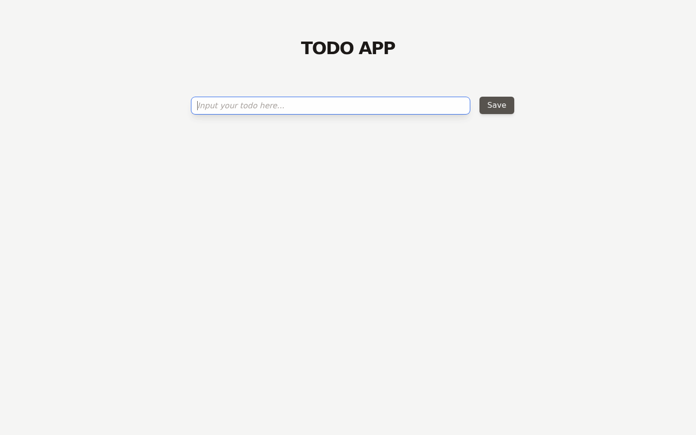

# Todo APP

A self-contained to-do list for one person. You add a task, tick it off when it is done, and remove it when it is no longer needed; Check All and Remove All act on the whole list at once. There is no sign-up, account, or server: the list is stored in your own browser and survives a page reload, but nothing is shared or synced between devices. It gives you a working task list with nothing to install or configure.



The list starts empty. Check All and Remove All stay hidden until at least one task exists.

## What you can do

- Type a task into the input field and press Save to add it to the list.
- Tick a task's checkbox to mark it done.
- Remove a single task with its X button.
- Use Check All or Remove All to act on every task at once; these buttons appear only after the first task is added.
- Come back to the same list later — saved tasks reload from the browser's local storage.

## How it works

The whole app is one static HTML page plus a small script that keeps the list in browser local storage under the key `todos`. Nothing runs on a server: the page loads its UI library and stylesheet as plain vendored files, and the container's only job is to serve those files with nginx on port 8080, falling back to the same page for any path. There is no build step and no API to call.

## Running it

There is nothing to install or build. Build the image from the repository root, run it, and open `http://localhost:8080`:

```
podman build -t todo-app .
podman run --rm -p 8080:8080 todo-app
```

You can also serve the repository root with any static HTTP server — the page makes no server-side requests, so a plain file server works too.

## Limitations

- There is no backend or sign-in, so tasks live only in this browser's local storage under `todos`. Clearing site data or browsing privately loses them, and they never appear on another browser or device.
- The list ships with no starting tasks; the Check All and Remove All controls only show up once you add one.
- How the vendored Vue and Tailwind files were obtained is not recorded — there is no `package.json` — and no manifest pins the exact Vue 3 version: both `3.0.8` and `3.2.31` appear in the vendored build.
